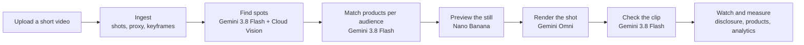

# Cameo

**Personalized ads, inside the story.**

Viewers skip ads, and product placement is fixed the day a scene is shot. Cameo places the right product for each
audience into finished video, after the fact: Gemini finds the spots a viewer would notice, Nano Banana previews the
product in place, and Gemini Omni edits the shot itself. One episode carries a different, natural-looking placement for
every audience, disclosed as "Sponsored placements" and shoppable on intent instead of through interruptions.

**Theme: Media, Content & Digital Experiences**, "an AI-powered solution that transforms how content is created,
discovered, personalized, understood, or experienced". Cameo does all five, on footage that already exists:

- **Understood:** Gemini watches each episode with its audio and maps every spot a product could take, and the scenes
  where none should.
- **Personalized:** the same shot carries a different product for each audience, matched by Gemini from the brand's
  catalog.
- **Created:** Gemini Omni turns an approved Nano Banana still into a new version of the finished shot, with no reshoot.
- **Discovered:** viewers find products inside the story, on their own terms, and save them for later.
- **Experienced:** no ad breaks; a labelled placement and a "Shop this scene" pill while a product is on screen.

## Why it matters

| Who | Today | With Cameo |
|---|---|---|
| Viewers | Ad breaks interrupt the story and are largely ignored: 24 % of US streaming viewers say they pay attention during ad breaks ([All About Cookies, 2026](https://ppc.land/most-streaming-viewers-ignore-ads-and-they-want-fewer-longer-ones/)), 86 % of Gen Z skip ads whenever they can ([Attest, 2026](https://www.askattest.com/our-research/2026-us-media-consumption-report)), and 73 % of Gen Z say the ads they see do not match their preferences ([Tubi and Harris Poll](https://cordcuttersnews.com/streamers-dont-mind-ads-if-content-is-free-tubi-research-shows/)). | The product sits inside the scene, labelled. Nothing stops the story; a viewer who is curious opens it. |
| Studios and creators | A placement is decided on set. Changing it later means a reshoot or VFX work: pulling one product from a K-drama's overseas streams took the producers "two or three more days" ([Korea Times](https://www.koreatimes.co.kr/www/nation/2021/03/688_306408.html)). | Any finished shot becomes sellable inventory, again and again, for every audience it reaches. Back catalogs included. |
| Brands, especially regional ones | Product placement is a ~$42 B market growing 13.7 % in 2026 ([PQ Media via MediaPost](https://www.mediapost.com/publications/article/418605/product-placement-growth-hits-recent-high-microdr.html)), priced for big budgets: a visual placement in a Bollywood film costs Rs 20–30 lakh ([afaqs](https://afaqs.com/news/mktg/brand-placements-in-srks-jawan-did-zomato-asian-paints-godrej-and-more-get-noticed)). Foreign brands already buy K-drama placements to reach export audiences ([Korea Times](https://www.koreatimes.co.kr/amp/entertainment/shows-dramas/20251101/why-are-so-many-actors-eating-kopiko-in-k-dramas-inside-netflixs-genie-make-a-wish-and-the-global-ppl-boom)). | A brand buys one audience in one shot. Each market sees a product it can actually buy there. In-scene placement works: Amazon reported +6.9 % favorability and +14.7 % purchase intent for an inserted product, vendor-measured ([MediaPost](https://www.mediapost.com/publications/article/373524/amazon-introduces-virtual-product-placement-highl.html)). |

Measured on the deployed app, one real session: an 8-second upload became a rendered, Gemini-checked clip about 5½
minutes later, human choices included, for **$0.40 of model calls** (detection $0.059, drawn-box identify $0.005,
prompt $0.002, preview still $0.042, Omni render $0.291). Each additional audience for the same shot adds its still,
render and check, about $0.35 (plus a one-call re-match, about a cent, if it was added later); nothing is reshot.

The social case: content makers earn from what they have already shot, regional businesses priced out of
placement today can buy one audience in one shot, and viewers keep watching the story, with every placement disclosed.

## What is new

The idea of changing a product after the shoot is not new. Amazon adds products to its own originals in post, Mirriad
and Ryff sold audience-targeted insertions, Rembrand places region-specific brands in creator videos, and YouTube has
announced dynamic sponsorships that creators can resell per market. Generative editors such as Runway Aleph and Google
Flow can insert an object into one clip. What none of them offers is the whole job, done by the owner of the footage,
with Gemini doing the work a VFX team and a media planner do today.

| | Managed placement services | Generative video editors | Cameo |
|---|---|---|---|
| Finding where a product fits | A vendor's team or proprietary scanning, campaign by campaign | You decide | Gemini watches the episode with its audio and proposes spots, skipping sensitive scenes |
| Choosing a product per audience | Set up with the vendor per campaign | One manual edit at a time | Gemini picks up to three products per spot for every audience in one call |
| Making the edit | Compositing in post by the vendor | One prompt, one clip | An approved Nano Banana still directs Gemini Omni; later cuts of a scene inherit the first cut's look |
| Quality control | Human review | You watch it | Gemini checks every render against the still and offers another take |
| Who runs it, how fast | Publisher deals, agency buys, own originals; weeks to "hours" | Anyone, one clip | Anyone with footage, self-serve in a browser; minutes per shot |
| What the viewer gets | The same episode; disclosure varies (CJ ENM does not disclose its AI insertions) | n/a | One episode per audience, labelled "Sponsored placements", products shoppable on intent, interest measured per audience |

Sources: [Amazon](https://techcrunch.com/2022/05/17/virtual-product-placement-ads-are-coming-to-amazon-prime-video-and-peacock/),
[Mirriad](https://videoweek.com/2023/01/23/the-ins-and-outs-of-virtual-product-placement/),
[Ryff](https://venturebeat.com/business/ryff-raises-5-million-for-virtual-product-placements),
[Rembrand](https://www.maginative.com/article/rembrand-raises-23m-to-bring-virtual-product-placement-to-connected-tv/)
("hours" per insertion: [Rembrand's CEO](https://pulse2.com/rembrand-omar-tawakol-profile/)),
[YouTube](https://digiday.com/future-of-tv/future-of-tv-briefing-youtubes-dynamic-brand-insertions-could-unlock-the-upfront-market-for-creators/),
[CJ ENM](https://v.daum.net/v/xjF5HAV7mM), [Runway Aleph](https://nofilmschool.com/runway-new-aleph-video-model),
[Flow Insert](https://9to5google.com/2025/10/15/veo-3-1/). The managed model has proved hard to scale: Mirriad, the
longest-running of these services, entered administration in 2026 after its revenue fell to about £0.4 M
([trading update](https://www.investegate.co.uk/announcement/rns/mirriad-advertising--miri/full-year-trading-update/9351714)).

The ideas that make it work:

- **Understand first, edit second.** Gemini reads the whole episode with its audio before anything is placed: scene,
  mood, people, camera, and every surface a viewer would notice. Placement follows the story instead of a grid of
  ad slots.
- **One shot, many audiences.** The audience is a first-class dimension from matching to playback: every box gets
  picks per audience, every approved still and render belongs to one audience, and Watch assembles one episode per
  audience.
- **Still first, video second.** A producer approves a $0.04 Nano Banana still before a ~$0.30 Omni render, and that
  still becomes Omni's visual reference. The video model is directed by an approved frame, not by a prompt alone.
- **Continuity across cuts.** When a scene has several shots, the first finished render is handed to Omni for the
  next one, so the product is the same product from every angle.
- **The model checks the model.** Gemini compares Omni's clip with the original shot and the still (products match,
  no new cuts, people unchanged). It flagged two of the five samples; the Render page shows why
  and offers another take.
- **Interest, not interruption.** In the player a "Shop this scene" pill appears only while a placed product is on
  screen; products open on a click, can be saved for later, and Analytics counts impressions, shop clicks, product
  views and saves per audience.

## How it works



1. **Find.** Gemini watches the whole episode once and lists every spot a product could take: an object to swap, a
   surface to set something on, a wall or screen to show an image. It then boxes those spots on keyframes, with Cloud
   Vision objects as context. Code drops sensitive scenes and boxes that are too small, hidden or over a face
   ([rules](#responsible-by-design)).
2. **Match.** One Gemini call picks up to three products per spot for each audience from the brand's catalog, explains
   each pick in a line, and writes the edit prompt. Draw your own box and Cloud Vision snaps it to the object under it
   while Gemini names it and suggests products.
3. **Follow.** Every box is tracked through its shot on CPU, so it glides with the footage and fades out when the spot
   leaves the frame; the page says when it comes into view.
4. **Preview.** Nano Banana edits the shot's keyframe with every product for one audience in place, using the product
   photos as references. Producers edit the prompt and approve.
5. **Render.** Gemini Omni edits the shot's own video to match the approved still, and Gemini checks the result
   ([details](#gemini-omni-the-video-edit)).
6. **Watch.** Each audience gets its own episode with its rendered shots cut in and the original audio, products
   beside the picture while they are on screen, and its own interest numbers in Analytics.

## Google AI in Cameo

| Product | Model | Used for | Code |
|---|---|---|---|
| Gemini on Vertex AI | `gemini-3.8-flash` | Video scene understanding, `box_2d` localization, product matching per audience, drawn-box identification, edit prompts, render checks. Structured output throughout. | `models.py`, `identify.py`, `render.py` |
| Cloud Vision API | Object localization | Objects on every keyframe as context; snapping drawn boxes to real objects. | `vision.py` |
| Nano Banana | `gemini-nano-banana-2.1` | Preview stills: the keyframe edited with each product, product photos as references. | `preview.py` |
| Gemini Omni | `gemini-omni-1.1-flash-preview` | The final video: edits each shot so its products match the approved still, frame by frame, keeping motion, length and people. [How below](#gemini-omni-the-video-edit). | `render.py` |

### Gemini Omni: the video edit

Gemini Omni is the step that turns a placement into finished video. Every clip on the Render and Watch pages, and every
"Placed by Gemini Omni" sample on the landing page, is Omni's output; nothing is composited or overlaid.

The call lives in [`agents/cameo_agents/render.py`](agents/cameo_agents/render.py) (`OmniVideo.edit`). It goes through
the Vertex AI Interactions API with the Gen AI SDK:

```python
client.interactions.create(
    model="gemini-omni-1.1-flash-preview",
    input=[
        {"type": "video", "data": shot_mp4, "mime_type": "video/mp4"},    # the shot itself, ≤ 10 s, 24 fps, no audio
        {"type": "image", "data": approved_still, "mime_type": "image/png"},  # <IMAGE_REF_0>: Nano Banana's approved frame
        {"type": "image", "data": earlier_cut, "mime_type": "image/jpeg"},    # <IMAGE_REF_1>: only for a later cut of a scene
        {"type": "text", "text": instruction},
    ],
    response_format={"type": "video", "resolution": "360p", "aspect_ratio": "16:9", "delivery": "inline"},
)
```

The instruction follows Google's guidance for edit prompts (short, "single continuous shot", end with "Keep everything
else the same"). This is the one used for the Second Cup sample:

> Single continuous shot, no cuts. Edit this video so it matches <IMAGE_REF_0>, an edited frame of this same shot: the
> plain white wall shows the Wanderly Goa getaways ad; the Munchbox Masala Makhana sits on the round marble table. The
> products look exactly as in <IMAGE_REF_0>, stay fixed in place for the whole shot, and move only with the camera.
> Keep everything else the same.

Around that call:

1. **Input.** The shot is cut from the upload at 24 fps, short side 720 px, without audio. Uploads are capped at
   10 seconds, Omni's input limit, so a shot always fits in one call.
2. **Reference.** The approved Nano Banana still is the ground truth for what the products look like. When another
   shot of the same scene was already rendered for this audience, its middle frame is added so the product stays
   identical across the cuts.
3. **Output.** Omni keeps the shot's frame count (192 frames in, 192 out on the samples). Cameo fits the clip to the
   shot's exact duration and puts the original audio back, since Omni writes its own soundtrack.
4. **Check.** Gemini 3.8 Flash watches the original shot and Omni's clip next to the still and answers three questions
   with structured output: do the products match and stay put, were cuts added, did any person change. A clip that
   fails is marked "Needs review" with Gemini's note, and the producer can ask Omni for another take.
5. **Episode.** For Watch, each audience's rendered shots are joined with the untouched shots and the original audio
   into one episode (ffmpeg, no model).

Renders are cached by every input that shapes them, so asking again is free. At most three run at once. Each one
reserves its estimated cost under the spending ceilings and gives it back if it fails. Omni's refusals (minors,
content rules, quota) are shown in plain words.

Each render stores Omni's own usage report (`out/<episode>/renders/<id>.json`): on the samples, 10,452 to 14,938
input and 11,586 to 17,379 output tokens per clip. Per-sample results are under [Measured on the samples](#measured-on-the-samples).

## Measured on the samples

Each sample on the landing page is a real run of this pipeline, served read-only by the deployed API with its outputs
(packed into the image by `agents/scripts/pack_samples.py`):
Gemini's spots, its picks for three audiences (India, Japan, Indonesia), the approved Nano Banana still and the Omni
render for one audience.

| Sample | Spots Gemini found | Picks per spot | Preview still (Nano Banana) | Render (Gemini Omni) |
|---|---|---|---|---|
| City train | 1: billboard on a skyscraper | a localized travel ad per audience | 18 s, $0.038 | 60 s, $0.29, passed the check |
| Mirror check | 2: wall beside the mirror, dress | poster; jacket picked by the producer | 16 s, $0.038 | 46 s, $0.22, passed |
| Second Cup | 4: wall, café table, two sweatshirts | up to 3 per spot per audience | 27 s, $0.043 | 63 s, $0.29, passed |
| Park walk | 2: billboard, tote bag | travel ad, tote | 19 s, $0.040 | 72 s, $0.33, flagged: tote graphic appears late |
| Study break | 6: sweatshirt, snack pouch, mug, book and more | sweatshirt, snack, drinks | 20 s, $0.049 | 73 s, $0.33, flagged: pouch text distorted |

Detection of an 8 to 10 s clip on the deployed app: 5 Gemini calls plus Cloud Vision, $0.05 to $0.06. Product
matching for a 4-spot, 3-audience episode runs in 8 to 12 s at low thinking, with the same top pick for every spot and
audience as the default level, which took 24 to 56 s (see [architecture](docs/architecture.md#why-it-is-built-this-way)).

## Responsible by design

- **Disclosed.** Every episode with placements plays under a "Sponsored placements" label. A swapped product is both
  synthetic media and a paid placement, which new rules treat that way: India's IT Rules require labels on synthetic
  content ([Hogan Lovells](https://www.hlc.com/en/publications/india-introduces-mandatory-labelling-for-ai-and-3hour-takedown-for-illegal-content)),
  Japan prohibits undisclosed advertising ([DLA Piper](https://www.dlapiper.com/insights/publications/2023/07/consumer-protection-in-japan-new-law-prohibits-stealth-marketing)),
  and the EU AI Act's transparency duties apply from August 2026 ([ICT Recht](https://www.ictrecht.nl/en/blog/heads-up-ai-act-transparency-obligations-now-in-effect)).
  Google marks Gemini Omni output with SynthID at generation ([IT Brief](https://itbrief.co.uk/story/google-launches-gemini-omni-flash-for-video-editing)).
- **Placement knows when to stay out.** Scenes of grief, bad news, medical distress or minors at risk get no
  placements, and no box may cover a face. Gemini only rates each scene; code makes the call (`schemas.py`, `pipeline.py`).
- **People stay who they are.** Only products change; Gemini's check fails any render where a face, body, pose or
  action changed, and Omni itself declines photorealistic minors.
- **A person approves.** Gemini proposes; the producer picks products, edits prompts, approves each still and accepts
  each clip. The original is never overwritten.
- **No surprise spending.** Every paid step shows its estimate first, and the server enforces daily dollar ceilings
  per browser, per network and overall (`limits.py`).

## Built to run

| Service | Used for |
|---|---|
| Cloud Run | The API: scales to zero when idle, one instance with CPU kept on while it works, so renders run in the background. |
| Firebase Hosting | The web app. |
| Cloud Storage | Durable copies of uploads, generated stills and clips, spending counters and analytics, so the API can sleep and redeploy without losing anything; uploads go straight to it through signed URLs. |
| Secret Manager | The operator dashboard's admin token. |
| Cloud Logging, Cloud Monitoring | Every visitor and generation event as structured logs; an alert policy that emails the operators when a spending ceiling is reached. |
| Cloud Build, Artifact Registry | Container builds from source on each deploy. |

- **Structured output everywhere.** Every Gemini call returns a Pydantic schema; code validates it and applies the rules;
  the matching call retries once on a malformed answer.
- **Pay once.** Every model result is cached by a hash of its inputs, so repeating a step is free and identical
  requests in flight share one call.
- **Isolated by browser.** Projects, catalogs, picks and approvals live in each browser and travel with requests;
  shared samples stay read-only on the server, and viewer analytics are counted per browser.
- **Operated.** An operator dashboard at `/admin` (admin token) shows visitors, samples opened, every model step,
  spend against the daily budget and a live feed, and can change the ceilings.
- **Fast enough to use live.** A sleeping server answers in about 6 s (measured cold start); detection of a short
  clip takes about a minute, a still about 20 s and a render about a minute, each with progress streamed to the page.
- **Fits existing systems.** Every step is a documented HTTP API ([docs/api.md](docs/api.md)); catalogs and audiences
  arrive as JSON; each audience's episode is an ordinary MP4 any player or CDN can serve; viewer events are one POST.
- **Tested.** 91 API tests run offline against stand-ins for Gemini, Cloud Vision, Nano Banana and Gemini Omni,
  building their own clips with ffmpeg; the web app type-checks in its build.

## Experience

User-friendly and accessible by design: a guided flow with no sign-up: Catalog → Scenes → Previews → Render → Watch → Analytics. Samples open finished, so
every page can be explored without spending anything. Long steps stream their progress, uploads show
bytes sent and time left, and a sleeping server shows "Waking up" instead of an error. The app works in light and dark,
on phones, with keyboard shortcuts (`?`), labelled controls and reduced motion respected.

## Prototype scope

Cameo is a hackathon prototype, built in one week to prove the core loop end to end on Google's models: find, match,
preview, render, check, watch and measure. It is deployed and usable, and deliberately stops short of a commercial
launch:

- **Short clips.** Up to 10 s per upload, Gemini Omni's input limit per call; renders at 360p, about $0.30 a clip.
- **One API instance.** Jobs live in memory; files are mirrored to Cloud Storage.
- **Demo content.** All sample footage is AI-generated (Veo in Google Flow), so no real person appears in it. Every
  brand is fictional, product photos are made with Nano Banana, and shop links are placeholders.
- **No business layer yet.** No accounts, pricing, billing or pilots. Uploads assume the uploader owns the footage;
  visitors are anonymous browser ids.
- **Evidence, not a benchmark.** Quality is shown on the five samples and live runs; the checks for minors and people
  rely on Gemini and Omni.

### Future scope

- **Pricing.** Per approved placement per audience, with a revenue share for the content owner: priced well below a
  traditional placement and well above the ~$0.35 it costs to make.
- **Pilots.** Short-drama studios and creators in India and Southeast Asia, measuring shop rate against the plain cut.
- **Rights and consent.** Rights confirmation at upload, talent consent records, brand restricted-category rules
  (alcohol, tobacco, medicines, children's content), C2PA provenance alongside SynthID, privacy notice and retention
  controls.
- **Quality.** An accuracy benchmark; self-healing renders that rewrite the prompt and retry when the check fails;
  masks plus tracking for occluded products; longer episodes and HD.
- **Scale and distribution.** A Cloud Tasks render queue for whole seasons, Vertex AI Vector Search for large
  catalogs, the right cut chosen at play time like ad insertion, and a player SDK for streaming and short-drama apps.

## Where to look

| Question | Evidence |
|---|---|
| Is Gen AI doing the core work? | [Google AI in Cameo](#google-ai-in-cameo); `agents/cameo_agents/models.py`, `identify.py`, `preview.py`, `render.py` |
| Does it work end to end? | The five samples in the live app, the measured session above, `agents/tests/` |
| What is original? | [What is new](#what-is-new); [Why it is built this way](docs/architecture.md#why-it-is-built-this-way) |
| Who benefits, and how much? | [Why it matters](#why-it-matters); unit cost under [Measured on the samples](#measured-on-the-samples) |
| Is it safe, scalable and does it fit existing systems? | [Responsible by design](#responsible-by-design), [Built to run](#built-to-run), [Prototype scope](#prototype-scope) |

## Try it

Pick a sample on the landing page: each opens finished, with its spots, previews and rendered clips. Or upload a
video (the first 10 seconds are processed), add products to the spots Gemini found and generate your own.

## Run locally

Requirements: Python 3.11, Node 22, ffmpeg, and a Google Cloud project with the Vertex AI and Cloud Vision APIs
enabled (`gcloud auth application-default login`).

```sh
# API on :8787
cd agents
python3.11 -m venv .venv && .venv/bin/pip install -r requirements.txt
cp .env.example .env            # set GOOGLE_CLOUD_PROJECT
scripts/run_api.sh

# Web app on :5181
cd web
npm install
cp .env.example .env            # VITE_API_URL=http://localhost:8787
npm run dev
```

Tests run offline with stand-in backends: `cd agents && .venv/bin/pip install pytest httpx && .venv/bin/python -m pytest`,
and `cd web && npm run build`.

## Deploy

```sh
# Once per project: the admin token in Secret Manager, readable by the Cloud Run service account
openssl rand -hex 24 | gcloud secrets create cameo-admin-token --data-file=-
gcloud secrets add-iam-policy-binding cameo-admin-token \
  --member serviceAccount:<service-account> --role roles/secretmanager.secretAccessor

# Once per project: an email channel and the alert policy that mails every `cameo_alert` log line
gcloud beta monitoring channels create --type email --display-name "Cameo operators" \
  --channel-labels email_address=<you@example.com>
gcloud alpha monitoring policies create --policy-from-file agents/deploy/alert-policy.json \
  --notification-channels <channel-id>

# API on Cloud Run (the service account needs Vertex AI User, Cloud Vision access and Storage Object User on the bucket).
# pack_samples.py copies the ready-made samples into the image; the bucket keeps uploads and state while the
# service scales to zero.
agents/.venv/bin/python agents/scripts/pack_samples.py
gcloud run deploy cameo-api --source agents --region us-central1 --allow-unauthenticated \
  --memory 4Gi --cpu 2 --no-cpu-throttling --min-instances 0 --max-instances 1 --timeout 3600 \
  --set-env-vars GOOGLE_CLOUD_PROJECT=<project>,CAMEO_BUCKET=<bucket>,CAMEO_CORS_ORIGINS=https://<site>.web.app \
  --set-secrets CAMEO_ADMIN_TOKEN=cameo-admin-token:latest

# Web app on Firebase Hosting
cd web && VITE_API_URL=<cloud-run-url> npm run build && firebase deploy --only hosting
```

## Repository

```
agents/                 Python API (FastAPI)
  cameo_agents/
    api.py              endpoints and jobs
    ingest.py           ffmpeg: shots, proxy, keyframes
    vision.py           Cloud Vision object localization
    models.py           Gemini: scenes, boxes, product match
    pipeline.py         detection stages and their guards
    identify.py         drawn boxes and edit prompts
    tracking.py         boxes followed through each shot
    preview.py          Nano Banana stills
    render.py           Gemini Omni clips, checks, masters
    limits.py           daily dollar ceilings per browser, network and server
    ops.py              visitor and generation analytics, operator dashboard endpoints
    storage_sync.py     durable copies in Cloud Storage
  scripts/              run the API, make samples, product photos
  deploy/               Cloud Monitoring alert policy
  tests/
web/                    React app (Vite, TypeScript, Tailwind)
docs/
  architecture.md       pipeline, rules, caching and cost
  api.md                endpoint reference
```

## License

[MIT](LICENSE)
