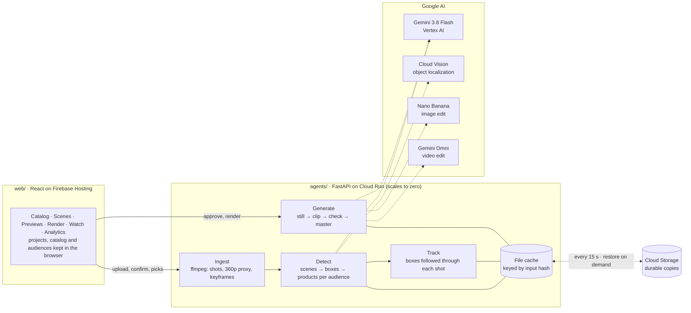
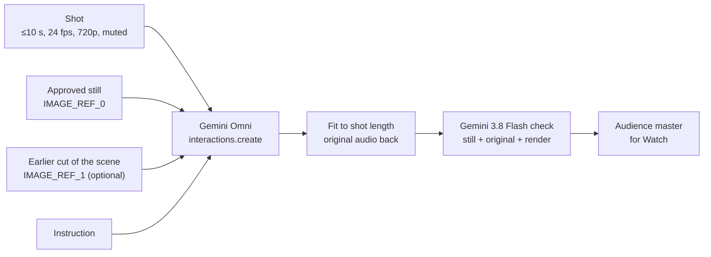

# Cameo architecture

## 1. Ingest (no model)

`ingest.py` cuts the upload into shots on real scene changes only (ffmpeg scene score), so a continuous take stays one
shot. It writes a 360p proxy, the audio and three keyframes per shot (start, middle, end). Uploads are capped at 10 s,
which is also the longest clip Gemini Omni edits in one call; a longer video can be trimmed to its first 10 s.

Before anything is spent, the job stops at `needs_confirmation` with the number of calls and the estimated cost.

## 2. Detect

| Step | Google AI | What it does |
|---|---|---|
| Objects | Cloud Vision | One `OBJECT_LOCALIZATION` request per keyframe, run in parallel with stage 1. The objects become context for Gemini's prompts and the snapping target for drawn boxes. |
| Stage 1 | Gemini 3.8 Flash | One video call on the 360p proxy at 1 fps with audio. Per shot: scene type, mood, people, camera motion, sensitivity, the spots a viewer would notice (objects to swap, surfaces to set a product on, flat areas for an image), dialogue cues, the scene group and camera setups. |
| Stage 2 | Gemini 3.8 Flash | One call per keyframe: tight `box_2d` boxes and masks for the stage-1 spots and for every face, in parallel. |
| Stage 3 | Gemini 3.8 Flash | One call for the whole episode: up to three products per box per audience from the browser's catalog, a one-line reason each, and the edit prompt for the top pick. |

Every call uses structured output (a Pydantic response schema). Code, not the model, applies the rules:

- **Sensitive scenes are skipped.** A scene rated high or critical, or whose mood and reasons describe distress (grief,
  bad news, medical distress, minors at risk), gets no placements.
- **Boxes are guarded.** A box under 1.5 % of the frame, more than 60 % hidden by hands, or covering a face is
  dropped; duplicates of the same spot are merged, and a spot seen across shots is linked.
- **Products are filtered.** A pick must be in the catalog and available to that audience (audiences can inherit from
  another with `basedOn`).

The shared placement rules in the prompts keep edits believable: a product appears in one of three ways (swap an
object or garment, set it onto a surface, or show it on a flat area); clothing is replaced or layered over; the product
faces the camera; and when someone is using the object being replaced, the use follows the new product (a snack eaten
from a new pack is that pack's snack).

**Drawn boxes.** A box the producer draws is snapped by Cloud Vision to the object under it (when they overlap enough),
then Gemini names it in the scene's context, decides how a product can appear there and picks products per audience
(`identify.py`).

## 3. Track (no model)

Gemini boxes each spot on a few keyframes. `tracking.py` carries every box through its shot with OpenCV's ViT tracker
on CPU, forward and backward from each keyframe where Gemini saw it. A track is trusted only while the tracker is
confident, the box still looks like the keyframe crop and keeps a plausible size, and it never crosses a keyframe where
Gemini looked and did not see the spot. Past that the spot counts as out of view, so the Scenes overlay fades it out and
shows when it comes into view instead of leaving a box on the wrong thing. Tracks are smoothed with no lag and stored at
10 samples a second.

## 4. Generate

| Step | Google AI | What it does |
|---|---|---|
| Edit prompt | Gemini 3.8 Flash | For a product the producer picked, Gemini writes the edit instruction for that box (`/prompt`). |
| Preview | Nano Banana | The shot's keyframe edited with every product of one audience in place, with each product photo as a reference image. Output is fitted back to the frame's exact size. |
| Render | Gemini Omni | The shot's own video edited so its products match the approved still: "single continuous shot, no cuts", the still as `IMAGE_REF_0`, and for a later cut of the same scene a frame of the earlier render as `IMAGE_REF_1` so the product stays identical across cuts. 360p. |
| Check | Gemini 3.8 Flash | The original shot, the render and the still in one call: do the products match, were cuts added, did people change. A failed check offers another take. |
| Master | (ffmpeg) | The episode for one audience: rendered shots cut in, the original audio throughout. |

### Render with Gemini Omni

`render.py` runs one Omni call per shot and audience (`POST /episodes/{id}/renders`, then poll the render):

- **Call.** `OmniVideo.edit` sends the shot as video, the references as images and the instruction as text through
  the Vertex AI Interactions API (`client.interactions.create`, model `gemini-omni-1.1-flash-preview`, location
  `global`), asking for an inline 360p video at the episode's aspect ratio (16:9 or 9:16). Usage (input and output
  tokens) comes back with the video and is stored with the render; cost is computed from it.
- **Instruction** (`instruction()`). "Single continuous shot, no cuts", then what changes ("the plain white wall shows
  the Wanderly Goa getaways ad"), that the products look exactly as in `IMAGE_REF_0` and move only with the camera or
  the hand holding them, the same visibility and interaction rules the stills use, the continuity line when there is
  an `IMAGE_REF_1`, and "Keep everything else the same".
- **Continuity** (`continuity_frame()`). Gemini's scene understanding groups shots into scenes (`sceneGroup`). When
  another shot of the same scene already has a finished render for this audience, its middle frame becomes
  `IMAGE_REF_1`, so a product seen from two angles stays the same product.
- **After the call** (`finish()`). The clip is fitted to the shot's exact duration (Omni keeps the frame count; the
  last frame is held if it comes back a frame short) and gets the shot's original audio.
- **Check** (`OmniVideo.verify`). One Gemini 3.8 Flash call with the still, the original shot and the render returns
  `productsMatch`, `newCuts`, `peopleChanged` and a one-line note. A clip passes only on all three; otherwise the
  Render page shows "Needs review" with the note and offers another take (`attempt` is part of the cache key, so a
  retry is a new call). A failed check never hides a finished clip.
- **State.** A render's record (`renders/<id>.json`) holds its status, stage, prompt, usage, cost, timing and verdict;
  the clip and its poster sit beside it. Requests are keyed by every input that shapes the result (shot, still,
  instruction, resolution, model, attempt, continuity frame), so asking again returns the same render. Renders run in
  background threads (Cloud Run keeps CPU allocated), three at a time, and survive the page being closed.
- **Failures.** Omni's refusals are translated (`friendly()`): photorealistic minors, content rules, quota. A failed
  render gives its spending reservation back.

## Why it is built this way

- **Gemini understands; code decides.** The model rates sensitivity, describes scenes and proposes spots; deterministic
  code turns those answers into decisions (skip a scene, drop a box over a face, keep a product an audience can buy).
  The rules are testable and the same for every run, and a prompt change cannot quietly loosen them.
- **The whole episode first, then frames.** Stage 1 is one video call with audio at 1 fps, so Gemini judges a spot in
  the context of the story (mood, dialogue, who is in the scene) before stage 2 boxes it on three keyframes. Boxing
  every frame with a model would cost more and drift; CPU tracking between keyframes, bounded by what Gemini saw,
  keeps boxes on the footage for free.
- **Cloud Vision grounds Gemini.** Vision's objects go into Gemini's prompts as context and give a drawn box a real
  object edge to snap to, so a producer's rough rectangle becomes the object they meant.
- **Thinking where it pays.** Scene understanding and boxing run at Gemini's default thinking level. Matching runs at
  low thinking: on a 4-spot, 3-audience episode it picked the same top product for every spot and audience as the
  default level, in 8 to 12 s instead of 24 to 56 s, and without thinking tokens crowding out the JSON answer.
- **Built for a shared, busy service.** Every Vertex call retries a 429 with truncated exponential backoff and jitter,
  as Google recommends for shared capacity. Keyframe calls are also hedged: most answer in 7 to 18 s, but about one in
  six stalls for 60 to 100 s with an ordinary answer, so a call still waiting after 20 s is sent once more and the
  first answer wins. A stall then costs about 20 s plus one normal call instead of a minute or more; when nothing
  stalls, nothing extra is sent.
- **Cheap decisions before expensive ones.** Detection (about $0.05) stops for confirmation; a still (about $0.04) is
  approved before a render (about $0.30); the render reuses that still as its reference. Each step narrows what the
  next, costlier model has to get right.
- **Audience as a dimension, not a copy.** Spots, tracks and the shot itself are shared; only picks, stills, renders
  and the assembled episode are per audience. A new audience costs a re-match (one Gemini call, about a cent), its stills and its renders, never a new detection.

## State and cost

- **The server can sleep.** Cloud Run scales the API to zero when nobody uses it. Everything it writes (uploads,
  generated stills and clips, spending counters, the activity log) is copied to a private Cloud Storage bucket every
  15 seconds and once more on shutdown (`storage_sync.py`). On start it restores the counters and the log; an episode
  comes back the first time it is asked for. A store that does not answer never stops the server starting.
- **The browser owns the project.** Projects, the catalog, audiences, box picks and approvals live in the browser
  (Zustand, persisted). Requests carry what the server needs, so the API keeps no user state.
- **Every model result is cached by its inputs** (`out/<episode>/cache`, `identify`, `prompts`, `previews`, `renders`,
  `tracks`). Asking again costs nothing, and identical previews or renders requested at the same time share one call.
- **Spending is visible first.** Detection and re-matching wait for confirmation with an estimate; Generate all and
  Render all show the price before they run.
- **Spending has dollar ceilings on the server** (`limits.py`), never per-request counts, so visitors can try
  everything freely. Each paid request reserves its estimated cost and a cached answer gives it back; a request is
  refused only when it would take one browser past $10, one network past $25 or the server past $60 for the day
  (adjustable on `/admin`). Reaching a ceiling, or 80 % of the server budget, logs one alert that Cloud Monitoring
  emails to the operators. At most three Omni renders run at once, uploads pause when stored uploads pass a size limit,
  uploads are reachable only through their own unguessable link, and samples are read-only on the server.
- **Operations are measured** (`ops.py`, `/admin`). The server records visits, uploads, detections, previews, renders,
  drawn boxes, prompts and refusals with their cost, to a local log and to Cloud Logging. The operator dashboard,
  behind an admin token, shows visitors, samples opened, every model step, spend against the daily budget and a live
  activity feed, and can change the ceilings, unblock a browser or network, and send a test alert. Visitors are anonymous browser ids; network addresses
  are stored only as salted hashes.

Approximate cost for one 10-second, single-shot clip and one audience:

| Step | Cost |
|---|---|
| Detection (Vision + 5 Gemini calls) | about $0.04 |
| Preview still (Nano Banana) | about $0.04 |
| Render (Gemini Omni, 360p) | about $0.036 per second, $0.36 for 10 s |
| Check (Gemini) | about $0.01 |

## Samples

A sample is an ordinary episode with an `out/<id>/sample.json` (`scripts/make_sample.py`) that names, per audience,
the products in its boxes, its approved still and its render. The browser seeds those on first open, so a sample shows
the finished work on every page without calling a model.
